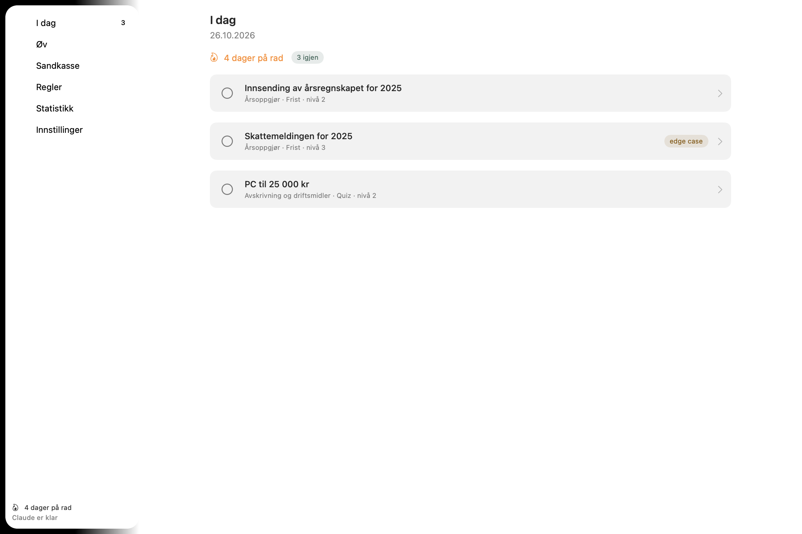
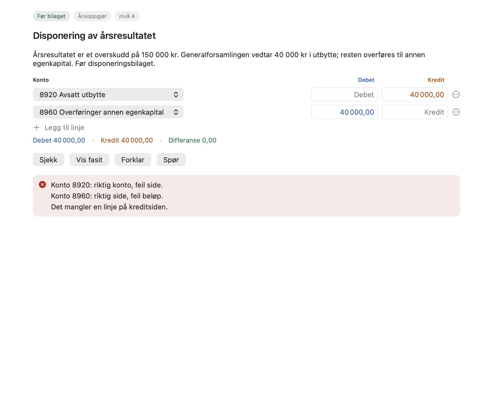
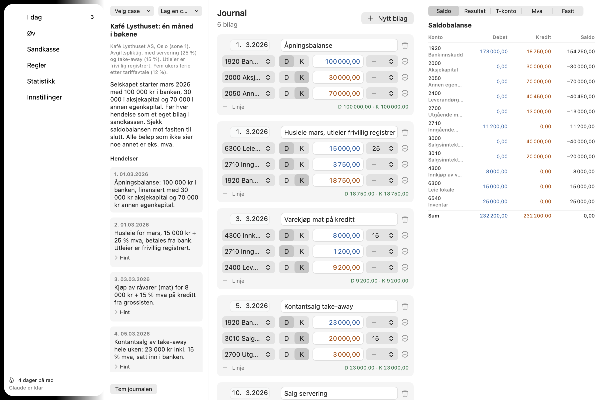

# Regnskapsskolen

En liten macOS-app i menylinjen som gir deg tre oppgaver om dagen i norsk regnskap: føre bilag, mva, lønn, frister, periodisering, avskrivning, årsoppgjør. Hver oppgave peker på paragrafen den bygger på. Det du får til, kommer sjeldnere tilbake; det du bommer på, kommer snart igjen (Leitner-bokser, 0–21 dager).

Med [Claude Code](https://claude.com/claude-code) installert kan appen forklare hvorfor et svar var feil, svare på spørsmål om oppgaven og lage en vanskeligere variant. Uten Claude virker alt annet som før.



| Oppgave med tilbakemelding | Sandkasse |
|---|---|
|  |  |

## Installer fra zip

1. Last ned `Regnskapsskolen-<versjon>.zip` under *Releases* og pakk ut.
2. Dra `Regnskapsskolen.app` til *Programmer*.
3. Appen er ad hoc-signert (inntil utgivelsene signeres med Developer ID), så macOS stopper den første gang med «Apple could not verify …». Trykk *Done*, åpne *Systeminnstillinger → Personvern og sikkerhet*, rull ned til meldingen om Regnskapsskolen og trykk *Åpne likevel*. Alternativ i Terminal: `xattr -dr com.apple.quarantine /Applications/Regnskapsskolen.app`. Oppdateringer appen installerer selv får ikke denne dialogen.
4. Finn bokikonet i menylinjen. Tallet er oppgavene som gjenstår i dag.
5. Gå gjennom oppsettet: når du vil minnes på, og om Claude skal brukes.
6. Appen sier fra i menylinjen når en ny versjon finnes; du trykker, den bytter seg selv ut og starter på nytt.

Krever macOS 15 eller nyere.

## Bygg selv

```sh
git clone https://github.com/Moen01/regnskapskolen.git
cd regnskapskolen
./scripts/onboard.sh
```

Skriptet sjekker Xcode og Swift 6, ser etter Claude Code, bygger appen, legger den i `/Applications`, peker den på `Innhold/` i repoet (så oppgaver du eller Claude skriver, vises uten ny bygging) og åpner den. Andre kommandoer: `make test`, `make app`, `make run`, `make install`, `make icon`.

## Oppdateringer

Appen sjekker nyeste utgivelse på GitHub 30 sekunder etter start og hver sjette time (kan slås av i Innstillinger). Finnes en nyere versjon, får du knappen **Oppdater til X.Y.Z** i menylinjen og **Oppdater og start på nytt** i Innstillinger → Oppdateringer, med utgivelsesnotatene under, og én varsling. Appen laster ned `Regnskapsskolen-<versjon>.zip` fra utgivelsen, pakker ut, kontrollerer signaturen (`codesign --verify`), bytter seg selv ut og starter på nytt. En app signert med Developer ID godtar bare en oppdatering fra samme Apple-team. En ad hoc-signert utgivelse (uten hemmelighetene under) kontrolleres bare for at bundelen er hel; Developer ID anbefales. Et lokalt bygg (`make app`, `make install`) er et utviklingsbygg og oppdaterer aldri seg selv.

Publiser en versjon med en annotert tag; meldingen blir utgivelsesnotatet i appen:

```sh
git tag -a v0.2.0 -m "Regnskapsskolen 0.2.0: bankavstemming i sandkassen"
git push origin v0.2.0
```

Workflowen **Release** tester, bygger, signerer og notariserer når disse hemmelighetene finnes i repoet, og legger zip-en på utgivelsen:

| Hemmelighet | Hva det er |
|---|---|
| `DEVELOPER_ID_CERT_P12` | Sertifikatet **Developer ID Application** med privat nøkkel, eksportert fra Nøkkelringtilgang som .p12 og base64-kodet (`base64 -i cert.p12 \| pbcopy`) |
| `DEVELOPER_ID_CERT_PASSWORD` | Passordet du satte ved eksporten |
| `NOTARY_KEY_P8` | En App Store Connect API-nøkkel (Users and Access → Integrations → Team Keys, rollen Developer); innholdet i .p8-fila |
| `NOTARY_KEY_ID` | Nøkkelens ID |
| `NOTARY_ISSUER_ID` | Issuer ID over nøkkellisten |

Mer i `docs/releasing.md`.

## Claude

Knappene *Forklar*, *Spør* og *Vanskeligere oppgave* bruker Claude Code på din egen maskin, med din egen innlogging. Appen trenger ingen API-nøkkel.

```sh
curl -fsSL https://claude.ai/install.sh | bash   # installer Claude Code
claude auth login                                # logg inn
```

Det som sendes er oppgaven, fasiten, svaret ditt, regelkortene for temaet og satsene fra `Innhold/satser.json`. Fremdriften din (`~/Library/Application Support/Regnskapsskolen/fremdrift.json`) sendes aldri. Detaljer i [docs/claude.md](docs/claude.md).

## Daglig bruk

- **I dag**: dagens sett. Riktig på første forsøk flytter oppgaven opp en boks; feil sender den til boks 0.
- **Øv**: alle temaer med mestringsgrad. Oppgaver her teller for boksene, ikke for dagens sett.
- **Spill**: to korte runder. *Lynrunde* er 90 sekunder med quiz, mva og saker der riktige svar bygger combo og feil viser forklaringen; svarene teller i boksene som ellers. *Debet eller kredit?* er 60 sekunder med kontoer fra kontoplanen, piltaster eller D og K. Begge gir XP og nivåer (Lærling til Partner) og merker. Ingen lyd.
- **Sandkasse**: før en hel måned for en kafé eller en nettbutikk, se saldobalanse, resultat og balanse, T-konto og mva-oppgjør, avstem banken i Bank-fanen, og sjekk mot fasiten.
- **Regler**: korte kort om lovene oppgavene bygger på, med lenker til Lovdata.
- **Statistikk**: rekke, bokser og mestring per tema.
- **Innstillinger**: påminnelse, antall oppgaver, Claude-modell, innholdsmappe, utkast.

## Legg til oppgaver med Claude Code

Åpne en `claude`-økt i repoet. Skillene i `.claude/skills/` kjenner formatet:

```
/ny-oppgave mva quiz 2 4        # to quizer om mva på nivå 4, validert
/kvalitetssjekk lonn            # sjekk lov og regnestykker i et tema
/forklar omvendt avgiftsplikt   # forklaring fra regelkortene
/sandkasse-case lonn 3          # en ny case til sandkassen
/ukens-tema                     # fem oppgaver i hvert av de to svakeste temaene dine
```

Nye oppgaver får `status: utkast` til et menneske har lest dem. Appen viser utkast når *Vis utkast* er på i Innstillinger. Formatet står i [docs/innhold.md](docs/innhold.md).

## Mappestruktur

| Sti | Innhold |
|---|---|
| `Innhold/oppgaver/<tema>/*.json` | Oppgavene, én fil per oppgave |
| `Innhold/regler/*.md` | Regelkortene |
| `Innhold/sandkasse/*.json` | Casene til sandkassen |
| `Innhold/satser.json` | Satser og frister med kilde og dato |
| `Innhold/kontoplan.json` | Kontoplanen (NS 4102-utvalg) |
| `Innhold/temaer.json` | Temaene og rekkefølgen |
| `Innhold/prompter/*.md` | Systempromptene til Claude |
| `Sources/RegnskapKit/` | Innhold, sjekkere, planlegger, sandkasse, Claude-kjører. Ingen UI. |
| `Sources/Regnskapsskolen/` | Appen (AppKit + SwiftUI) |
| `Tests/RegnskapKitTests/` | Tester, inkludert validering av alt innhold |
| `docs/` | Innholdsformat, Claude, lovkilder, tekniske notater |
| `.claude/skills/` | Skillene over |

## Lovkilder og satser

Alle lover, forskrifter og satser oppgavene bruker, står i [docs/regler.md](docs/regler.md) med lenker. Satsene i `Innhold/satser.json` ble sjekket 26.10.2026.

**Oppdatere satser**: endre tallet i `Innhold/satser.json`, oppdater `gjelderFra` og `kilde`, og kjør `swift test`. Fristoppgavene (`frist`) regnes ut fra reglene der, så filene kan ikke drifte fra satsene. Oppgavetekster som nevner et tall, finner du med `grep`.
